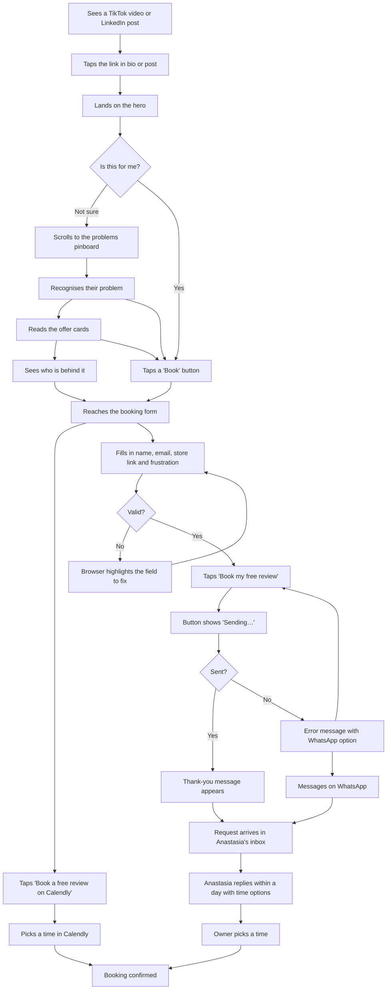

# User Flow: From Landing to a Confirmed Booking

This document maps the journey a store owner takes from first hearing about the free review to having a confirmed review time. It covers the main path, alternative paths, errors and what happens after the booking.

---

## Flow at a glance

---

## Step by step

### Step 1: Discover

| | |
|---|---|
| **Where** | TikTok (*Good UX for e-commerce websites*), LinkedIn carousels, direct shares |
| **What the owner does** | Watches a 30-second video or reads a carousel about one store problem, such as a confusing checkout |
| **What they think** | “That’s happening on my store.” |
| **What we provide** | A closing line inviting them to book a free review through the link |
| **Goal** | Get a click to the page |

### Step 2: Land on the hero

| | |
|---|---|
| **What they see** | The headline “Your store gets visitors. Let’s turn more of them into buyers.”, a supporting line, the “Book my free review” button and “No cost, no obligation” |
| **What they think** | “Is this for me? What does it cost?” |
| **Design response** | The headline speaks to store owners specifically. The note answers the cost question before it is asked. Text rises in with a short animation to draw the eye down the page |
| **Exit points** | Taps “Book my free review” or “Book a review” in the header and goes to Step 6, or scrolls on to Step 3 |

### Step 3: Recognise the problem

| | |
|---|---|
| **What they see** | The pinboard “The usual suspects behind lost sales”: five pinned panels connected by red threads to a centre card |
| **What they think** | “Carts left behind. Yes, that’s me.” |
| **Design response** | Captions use the owner’s own words. Threads draw toward the centre card to show that every problem leads to one fix. Hovering a panel lifts it closer |
| **Exit points** | Taps “Book my free review” on the centre card and goes to Step 6, or keeps scrolling |

### Step 4: Understand the offer

| | |
|---|---|
| **What they see** | “An honest look at your store, in 30 minutes” and three cards: a quick look at the store, the top three things costing sales, and clear next steps |
| **What they think** | “What exactly will I get? Is it worth 30 minutes?” |
| **Design response** | Each card names a concrete outcome. The third card promises value “whether you work with me or not”, which lowers the fear of a sales trap |
| **Exit points** | Taps “Book this review”, “Find my top three” or “Get my next steps” and goes to Step 6 |

### Step 5: Meet the person

| | |
|---|---|
| **What they see** | A photo of Anastasia, the audience statement and a one-line introduction |
| **What they think** | “Who am I sharing my store with? Is she real?” |
| **Design response** | A real face, a first-person introduction and a clear statement of who the review is for |

### Step 6: Reach the form

| | |
|---|---|
| **How they arrive** | By scrolling, or from any “Book” button or card link |
| **What happens** | The page scrolls smoothly to “Book your free review” and the cursor moves into the Name field, so they can start typing straight away |
| **If they already booked** | The form comes back so they can send another request |

### Step 7: Fill in the form

| Field | Required | Why it is asked |
|---|---|---|
| Name | Yes | To address them personally |
| Email | Yes | To reply and agree a time |
| Store link | Yes | To prepare the review before the call |
| Biggest frustration | No | To focus the review on what matters most to them |

The form takes under a minute. Each field has a visible label, a helpful example and the right keyboard on phones (email and URL keyboards).

### Step 7a: Book directly on Calendly

Below the form, “Prefer to pick a time yourself?” sits above a **Book a free review on Calendly** button. It opens [calendly.com/uiuxanastasiadesigns](https://calendly.com/uiuxanastasiadesigns) in a new tab, where the owner sees open 30-minute slots in their own time zone, picks one and enters their details. Calendly sends both of us a confirmation and a calendar invitation straight away. **The booking is confirmed**, and the journey continues at Step 12.

### Step 8: Submit

| Situation | What happens |
|---|---|
| A required field is empty or invalid | The browser points to the field and explains the problem in the visitor’s own language. Nothing is sent |
| All fields are valid | The button changes to “Sending…” and is disabled to prevent double submissions |
| The request is sent | Step 9 |
| The request fails | Step 8a |

### Step 8a: Recover from an error

The message “Something went wrong and your request wasn’t sent. Please try again, or message me on WhatsApp at +234 902 217 0871.” appears above the button. Everything they typed stays in the form. They can try again or switch to WhatsApp.

### Step 9: See the confirmation

| | |
|---|---|
| **What they see** | The form is replaced by “Thank you, your request is in. I’ll email you within a day to set up your review.” with a twinkling sparkle |
| **What they think** | “Good, I know what happens next.” |
| **Design response** | A clear time expectation. Keyboard and screen reader focus moves to the message so everyone knows it worked. A “Send another request” button lets agencies or multi-store owners book again |

### Step 10: Request arrives

The request lands in `uiuxanastasiadesigns@gmail.com` as a formatted email with the subject “New free website review request” and a table of the four fields.

### Step 11: Confirm the time

1. Anastasia looks at the store and notes first impressions.
2. Within one working day, she replies with her Calendly link, [calendly.com/uiuxanastasiadesigns](https://calendly.com/uiuxanastasiadesigns), so the owner can choose a time that suits them in their own time zone.
3. The owner picks a 30-minute slot.
4. Calendly sends the calendar invitation and video call details. **The booking is confirmed.**

### Step 12: The review and the next step

1. The 30-minute review covers the homepage, product pages and checkout.
2. Within 24 hours, the owner receives a written summary: one thing that works, the top three things costing sales, and the fixes.
3. The summary ends with the redesign offer: a fixed price, about two weeks of work, the store staying live during the rebuild, and conversion tracked before and after launch.

---

## Alternative paths

| Path | What happens |
|---|---|
| **Fast booker** | Hero → header or hero button → form → confirmation. Under 60 seconds |
| **Ready to commit** | Any “Book” button → Calendly button under the form → picks a time. Booking confirmed in about 2 minutes, with no email back and forth |
| **Careful reader** | Reads every section top to bottom, then books. About 2 to 3 minutes |
| **Chat preferrer** | Scrolls to the footer and taps WhatsApp. The conversation continues from Step 11 |
| **Keyboard user** | Uses the skip link to jump straight to the form, tabs through the fields and submits with Enter |
| **Reduced motion** | Same journey with all animation turned off |

---

## Success points to track

| Point in the flow | Measure |
|---|---|
| Step 2 | Visitors who scroll past the hero |
| Steps 2 to 6 | Clicks on each “Book” button and card link |
| Step 7 | Visitors who start the form |
| Step 7a | Clicks on the Calendly button and bookings made in Calendly |
| Step 9 | Requests sent |
| Step 11 | Reviews that get a confirmed time |
| Step 12 | Reviews that become paid redesigns |
